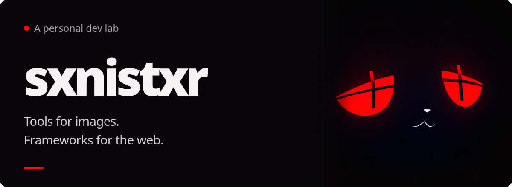
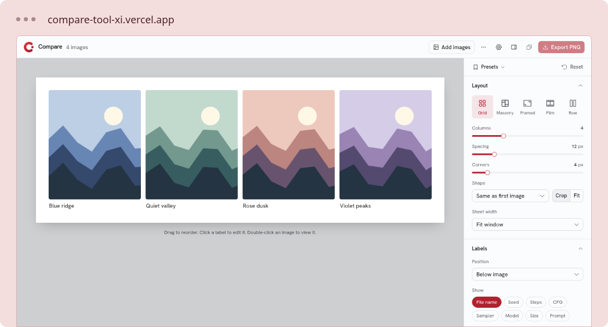
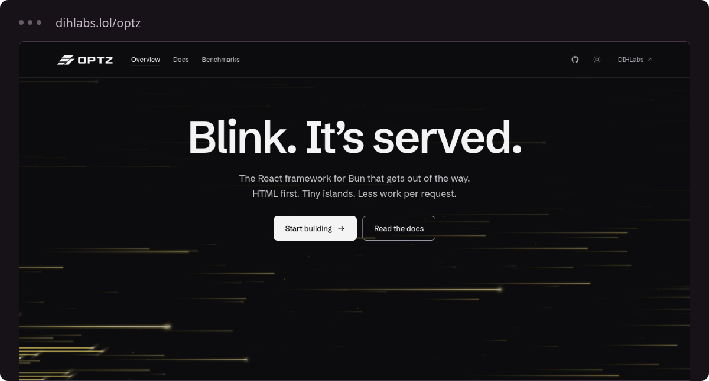

### Hey, I'm sxnistxr.

I build things I want to use. Here you'll find image tools, web experiments,
and **OPTZ**, the React framework for Bun behind my dev lab.

[Visit the lab](https://dihlabs.lol) &nbsp; / &nbsp; [Read the docs](https://dihlabs.lol/docs) &nbsp; / &nbsp; [Explore my repos](https://github.com/sxnistxr?tab=repositories)

**My toolkit** &nbsp; <code>TypeScript</code> <code>React</code> <code>Bun</code> <code>Rust</code>

 

## Compare

**A better view of your image experiments.**

Put SDXL outputs side by side, inspect their generation settings, and export
a comparison sheet. Made for the details you miss switching between tabs.

[Open Compare](https://compare-tool-xi.vercel.app) &nbsp; / &nbsp; [View source](https://github.com/sxnistxr/compare-tool)

Inside the tool

- Five layouts: Grid, Masonry, Framed, Film, and Row.
- Prompts, seeds, steps, CFG, samplers, and models from A1111 / Forge and ComfyUI PNGs.
- Editable labels, XY grid headers, and reusable presets.
- PNG, JPG, or WebP export at 2048 px, 4096 px, or full size.

Built with **TypeScript, Next.js, React, and Tailwind CSS**.

*Preview uses sample landscape illustrations.*

 

## OPTZ

**HTML first. Interaction where it belongs.**

A React framework for Bun with server-rendered pages, interactive islands,
typed routes and APIs, caching, and middleware. It's what runs my lab.

[Explore OPTZ](https://dihlabs.lol/optz) &nbsp; / &nbsp; [View source](https://github.com/sxnistxr/OPTZ) &nbsp; / &nbsp; [Documentation](https://dihlabs.lol/docs)

Inside the framework

- File-based routes, layouts, and typed APIs.
- Hydration for components marked as interactive islands.
- Full-stack starter and examples covering framework features.
- A workspace with the dev lab, Rust engine, benchmark sources, and deployment tooling.

Built with **TypeScript, React, Bun, and Rust**.

 

---

More experiments, notes, and things in progress at **[dihlabs.lol](https://dihlabs.lol)**.
