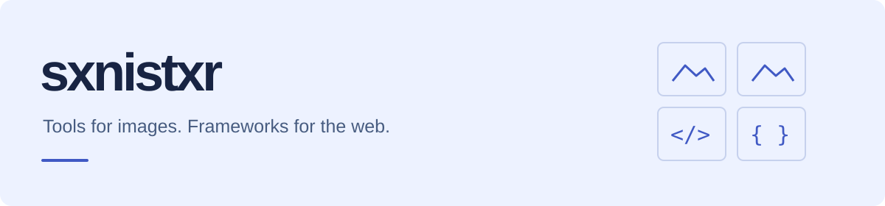
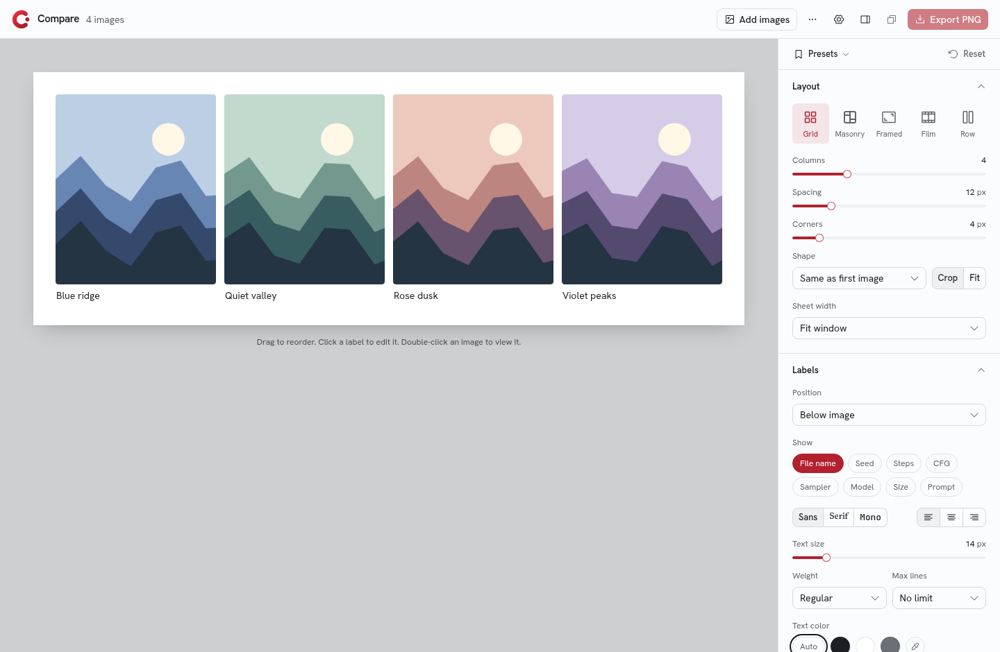
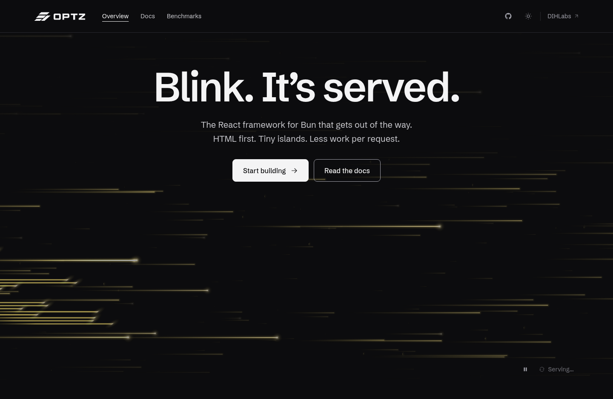

<picture>
  <source media="(prefers-color-scheme: dark)" srcset="assets/header-dark.svg">
  
</picture>

I build tools I want to use, from image comparison workspaces to a React framework for Bun.

[Dev lab](https://dihlabs.lol) · [Documentation](https://dihlabs.lol/docs) · [Repositories](https://github.com/sxnistxr?tab=repositories)

## Compare

**An image comparison workspace for SDXL experiments.** Arrange images, inspect generation settings, and export a labeled comparison sheet.

- Drop or paste images into Grid, Masonry, Framed, Film, or Row layouts.
- Read prompts, seeds, steps, CFG, samplers, and models from A1111 / Forge and ComfyUI PNG metadata.
- Add editable labels and XY grid headers; save a look as a preset.
- Export PNG, JPG, or WebP at 2048 px, 4096 px, or full size.

**Built with:** TypeScript, Next.js, React, Tailwind CSS.

[Try Compare](https://compare-tool-xi.vercel.app) · [Source code](https://github.com/sxnistxr/compare-tool)

## OPTZ

**A React framework for Bun, powering my dev lab.** Server-rendered pages with interactive islands, typed routes and APIs, caching, and middleware.

- Hydrate interactive islands while keeping the rest of the page server-rendered.
- Build with file-based routes, typed APIs, and framework caching.
- Start from examples covering full-stack apps and framework features.
- Explore the dev lab, documentation, Rust engine, and benchmark sources in one workspace.

**Built with:** TypeScript, React, Bun, Rust.

[Explore OPTZ](https://dihlabs.lol/optz) · [Read the docs](https://dihlabs.lol/docs) · [Source code](https://github.com/sxnistxr/OPTZ)

---

Find the experiments, implementation details, and tradeoffs in the repositories above.
